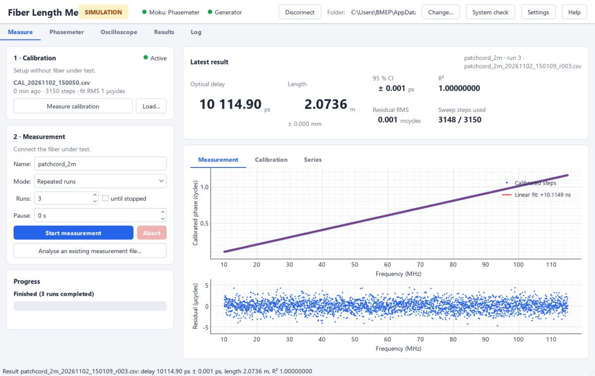

# FLS — Fiber Length Measurement (V2)

Measures the optical transfer delay and length of optical fibers with **picosecond precision**
using a swept-frequency intensity modulation and a phase-locked-loop phasemeter (Moku:Lab).
This is the acquisition and analysis software for the method published in:

> R. van Zutphen, P. R. Bloemen, T. G. van Leeuwen, X. Attendu,
> **Simple and cost-effective method to measure the length of optical fibers**,
> *Optics Letters* **50**(2), 329–332 (2025). <https://doi.org/10.1364/OL.546043>

If you use this software, please cite the paper (see [`CITATION.cff`](CITATION.cff)).



## Features

* Guided workflow: calibration → single or repeated measurements, automatic saving of raw data,
  settings and results (`results.csv`) per measurement folder.
* Robust per-sweep-step analysis (outlier rejection inside each frequency step, polynomial
  calibration with clipping, linear fit with clipping).
* **Phasemeter** diagnostics tab (all PLL/front-end settings, live lock/phase readout, arm and
  trigger the sweep from software) and **Oscilloscope** tab with phase difference between inputs.
* **System check** and **Find instruments**: tells the user what is missing and how to fix it.
* Simulation mode for training without hardware; tests run on simulated hardware.

## Hardware

Omicron LuxX laser (analog modulation) · fiber splitter (white = system, red = sample) ·
2 photodetectors · Liquid Instruments **Moku:Lab** (MokuOS ≥ 4.4) · Teledyne LeCroy **T3AFG**
waveform generator (USB) · Windows PC.

## Installation (summary)

The full, step-by-step guide — including the start-up procedure for every session — is in
**[docs/USER_GUIDE.md](docs/USER_GUIDE.md)** (also available in the program under *Help*).

Install yourself (cannot be bundled):

| | Download |
|---|---|
| Moku desktop app (USB driver, firmware updates) | <https://liquidinstruments.com/software/> |
| Moku CLI `mokucli` ≥ 4.4 (data streaming) | <https://liquidinstruments.com/software/utilities/> |
| VISA library (waveform generator): NI-VISA **or** R&S VISA | [NI-VISA](https://www.ni.com/en/support/downloads/drivers/download.ni-visa.html) · [R&S VISA](https://www.rohde-schwarz.com/applications/r-s-visa-application-note_56280-148812.html) |
| Omicron Control Center (laser) | supplied with the laser · <https://www.omicron-laser.de> |
| Moku instrument files (per firmware) | from within FLS: *System check → Download instrument files* |

Then either

* **Executable** — unzip `FLS_V2_<version>.zip` (see *Releases*) and run `FLS.exe`; or
* **From source** (Python ≥ 3.11):

  ```
  pip install -r requirements.txt
  python run.py              # python run.py --simulate   (no hardware)
  ```

On first start the **System check** opens; *Find instruments* fills in the instrument addresses.

## Building the executable

```
build_exe.bat              # -> dist\FLS\FLS.exe and dist\FLS_V2_<version>.zip
```

The script creates a private virtual environment, installs the requirements and PyInstaller,
builds a folder executable, and adds the source code, this documentation and `INSTALL.txt`.

## Development

```
python -m pytest tests     # end-to-end tests on simulated instruments
python run.py --check      # system check in the console
```

```
fls/
  app.py               entry point (logging, theme, --simulate, --check)
  settings.py          typed settings, persisted in %APPDATA%\FLS\settings.json
  core/                Qt-free: io, processing, sequence, storage, scope_analysis, system_check
  hardware/            moku.py (Moku API ≥ 4.4), wavegen.py (VISA/SCPI), simulated.py, base.py
  ui/                  main window, tabs (measure, phasemeter, oscilloscope, results), dialogs
docs/USER_GUIDE.md     user and installation guide
packaging/             PyInstaller spec, icon, INSTALL.txt
tests/                 pytest
```

## Contact

Robin van Zutphen — Amsterdam UMC, Biomedical Engineering and Physics.
