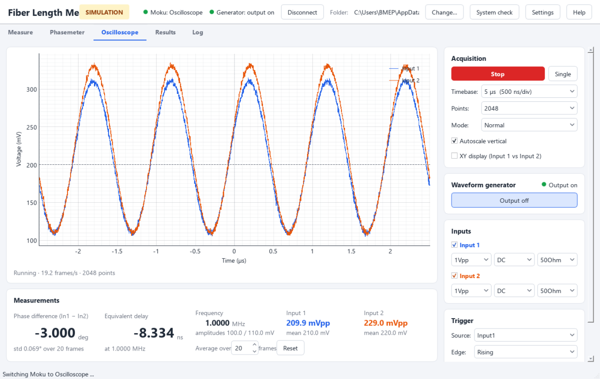
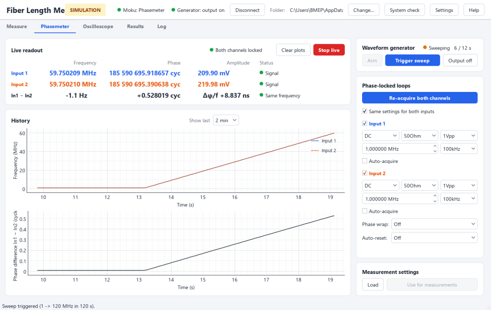
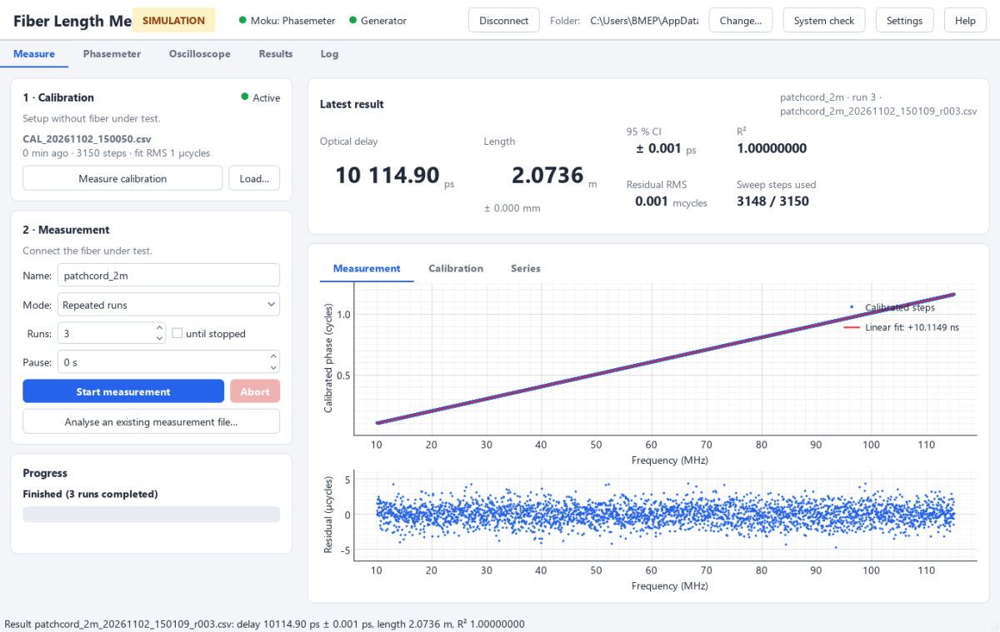

# FLS V2 — User guide

**Fiber Length Measurement** measures the optical transfer delay (and length) of optical fibers.
The laser intensity is modulated with a frequency sweep; a phase-locked-loop phasemeter tracks
the phase difference between a reference (system) path and the path with the fiber under test.
After subtracting a calibration, the slope of phase versus frequency is the delay of the fiber.

> R. van Zutphen, P. R. Bloemen, T. G. van Leeuwen, X. Attendu, *Simple and cost-effective method
> to measure the length of optical fibers*, Optics Letters **50**(2), 329–332 (2025).
> <https://doi.org/10.1364/OL.546043>

**Contents**

1. [Overview: what is included, what you install](#1-overview-what-is-included-what-you-install)
2. [Installation](#2-installation)
3. [Start-up procedure (every session)](#3-start-up-procedure-every-session)
4. [Measuring](#4-measuring)
5. [Data and files](#5-data-and-files)
6. [How the analysis works](#6-how-the-analysis-works)
7. [Troubleshooting](#7-troubleshooting)
8. [Reference](#8-reference)

---

## 1. Overview: what is included, what you install

The setup consists of a laser (Omicron LuxX 1310 nm, analog intensity modulation), a fiber
splitter with a **white (system/reference)** and a **red (sample)** fiber, two photodetectors,
a **Moku:Lab** (used as phasemeter and oscilloscope) and a **Teledyne LeCroy T3AFG** arbitrary
waveform generator (WGEN) that drives the laser modulation. The FLS software controls the Moku
and the WGEN; the laser is controlled with Omicron's own software.

| Component | Included in FLS | You download / install | Checked by *System check* |
|---|---|---|---|
| FLS program, Python and all Python packages (PyQt5, pyqtgraph, numpy, pandas, moku, pyvisa, zeroconf, pydantic, requests) | **Yes** (executable) | – (or `pip` when running from source) | Yes |
| Moku desktop app (contains the **Moku USB driver**) | No | **Yes** | Indirectly (Moku reachable) |
| **Moku CLI** (`mokucli`, needed for data streaming) | No | **Yes** | Yes (presence, version ≥ 4.4) |
| **Moku instrument files** (FPGA bitstreams, ~130 MB, per firmware version) | No | **Yes** (one button / one command) | Yes (for the connected firmware) |
| **VISA library** (USB communication with the WGEN) | No | **Yes** (NI-VISA or R&S VISA) | Yes |
| **Omicron Control Center** (laser control) | No | **Yes** | No (not used by FLS) |
| Moku firmware MokuOS **4.4 or newer** | – | Update via the Moku app if older | Yes |

---

## 2. Installation

### 2.1 Requirements

* Windows 10 or 11, 64-bit, with administrator rights (drivers).
* Three free USB ports (Moku, WGEN, laser) or a USB hub.
* About 2 GB free disk space (most of it for NI-VISA; R&S VISA is much smaller).

### 2.2 Step by step

Do the steps in this order; restart FLS after installing drivers.

1. **Moku desktop app (USB driver).**
   Download the *Moku:* app from Liquid Instruments
   (<https://liquidinstruments.com/software/>) and install it. It installs the Windows driver
   that makes the Moku reachable over USB (as a network adapter with an IPv6 address). If the
   Moku firmware is older than MokuOS 4.4, update it with this app (the app offers it when you
   connect).

2. **Moku CLI (`mokucli`).**
   Download *Moku CLI* from the Liquid Instruments utilities page
   (<https://liquidinstruments.com/software/utilities/>) and install it with the default
   settings. FLS finds it in `C:\Program Files\Liquid Instruments\Moku CLI\` or via the PATH.
   Background: <https://apis.liquidinstruments.com/starting-python.html>.

3. **VISA library** (for the waveform generator). Install **one** of:
   * NI-VISA: <https://www.ni.com/en/support/downloads/drivers/download.ni-visa.html> (large), or
   * R&S VISA (small, free): <https://www.rohde-schwarz.com/applications/r-s-visa-application-note_56280-148812.html>.

   No Teledyne-specific driver is needed; the T3AFG is a standard USB-TMC device.

4. **Omicron Control Center** (laser). Install the laser control software supplied with the
   Omicron LuxX laser (USB stick / download area of <https://www.omicron-laser.de>; ask
   Omicron support, mail@omicron-laser.de, if you do not have it). FLS does not talk to the
   laser, but you need this software for the laser check in the start-up procedure.

5. **FLS itself.**
   * *Executable (recommended):* unzip `FLS_V2_<version>.zip` to a folder of your choice
     (e.g. `C:\FLS`) and start `FLS.exe`. Create a desktop shortcut if you like. The folder
     `source\` contains the complete source code as backup.
   * *From source:* see [2.6](#26-running-from-source-and-building-the-executable).

6. **First start.** FLS opens the **System check** automatically (later: *System check* button
   in the header).
   * Switch on the Moku and the WGEN and connect their USB cables.
   * Press **Find instruments…**, select the Moku and the waveform generator, press
     **Use selected**.
   * If *Moku instrument files* is red, press **Download instrument files**. A console window
     opens and downloads ~130 MB; press **Run again** when it is finished.
   * All lines should be green. Every red line tells you how to fix it.

7. **Optional: try without hardware.** Start FLS with the `--simulate` option
   (`FLS.exe --simulate`, or `start_fls_simulated.bat` from source). Everything works with
   synthetic data, 10× faster than real time — useful for training.

### 2.3 What the System check does

The check is read-only: it asks the Moku for its description (no instrument is deployed), lists
the USB/VISA devices and asks the generator for its identity. A copy of the last report is saved
in `%APPDATA%\FLS\system_check.txt` (useful when asking for help — or use **Copy report**).

| Check | What it means | Typical fix |
|---|---|---|
| Python packages | (source only) all required packages installed | `pip install -r requirements.txt` |
| Moku CLI | `mokucli` found and version ≥ 4.4 | Install / update Moku CLI |
| VISA library | a VISA implementation is installed | Install NI-VISA or R&S VISA |
| Waveform generator | the configured VISA address is present | Switch WGEN on, USB cable, *Find instruments* |
| Moku reachable | the Moku answers at the configured address | Moku on (wait ~1 min), USB, Moku app installed, *Find instruments* |
| Moku firmware / Python package | firmware API matches the moku package in FLS | Update the Moku (app) or update FLS |
| Moku instrument files | bitstreams for the Moku's firmware build are present | *Download instrument files* |
| Measurement folder | the data folder exists and is writable | Choose another folder |

### 2.4 Instrument addresses

* **Moku**: over USB the Moku has an IPv6 link-local address in brackets, e.g.
  `[fe80::7269:79ff:feb7:2ff]`. It is derived from the Moku's hardware address: the same Moku has
  the same address on every computer. `mokucli list` shows it with a `%<number>` suffix — that
  number is your computer's network adapter and must **not** be entered. If the Moku is on the
  network (Ethernet/Wi-Fi) you can use its IPv4 address instead.
* **Waveform generator**: VISA address like `USB0::0xF4ED::0xEE3A::T0102C23370246::INSTR`; the
  last part is the generator's serial number (same on every computer).
* *Find instruments* fills in both. Manually: *Settings → Instruments*.

### 2.5 Updating

* **Moku firmware update** (via the Moku app): afterwards run the System check. New instrument
  files are needed (*Download instrument files*). A major firmware update may also need a newer
  FLS (check *Moku firmware / Python package*).
* **New FLS version**: unzip it next to / over the old folder. Settings
  (`%APPDATA%\FLS\settings.json`) and data are kept.

### 2.6 Running from source and building the executable

```
git clone <repository>  (or unzip the source folder)
cd V2
python -m pip install -r requirements.txt     # Python 3.11 or newer
python run.py                                 # or: python run.py --simulate
python run.py --check                         # system check in the console
python -m pytest tests                        # tests (simulated hardware)
build_exe.bat                                 # builds dist\FLS_V2_<version>.zip
```

`build_exe.bat` creates a private virtual environment (`.build-venv`), installs the packages
and PyInstaller, builds `dist\FLS\FLS.exe`, copies the source code and this guide into it and zips
everything. The drivers (Moku app, Moku CLI, VISA) and instrument files are never bundled.

---

## 3. Start-up procedure (every session)

Follow these steps at the start of every session, in this order. They verify the optical and
electrical chain before a 2-minute measurement is spent.

### 3.1 Power on

1. **Moku:Lab** — switch on and wait until it has fully booted (~1 minute).
2. **Both photodetectors** — switch on (check the batteries/power supply).
3. **Waveform generator (T3AFG)** — switch on.
4. **Laser** — switch on (key switch) and start it as usual.

### 3.2 Calibration setup

1. **Clean all fiber connectors** (end faces) before plugging them in. Dirty connectors cause low
   and unstable signals.
2. Plug the **white fiber (system / reference path)** and the **red fiber (sample path)**
   **directly into the two photodetectors** — no patch cords or fiber under test in between.
   This is the **calibration setup**.
3. Check the BNC cables from the photodetectors to Moku inputs 1 and 2.

### 3.3 Start FLS and connect

Start FLS and press **Connect** (header). The *Moku* and *Generator* lights turn green.
Check the measurement folder in the header (*Change…* to select another).

### 3.4 Arm the generator and check the laser (Omicron Control Center)

1. Go to the **Oscilloscope** tab and press **Output on (sweep start)** ("arm the WGEN").
   This programs the generator with the sweep used for measurements — sine, 1 → 120 MHz in
   120 s, 0.6 Vpp amplitude, 0.6 V offset, manual trigger — and switches its output on. Until a
   sweep is triggered, the generator stays at the **start frequency, 1 MHz**, so the laser
   intensity is modulated at 1 MHz.
2. Open the **Omicron Control Center** and check:
   * the **output power is oscillating** (modulation visible) and is **not hitting saturation**
     (not clipped at the maximum);
   * the **system interlock / key switch** is not blocking emission;
   * the laser is set to **analog modulation**.
3. The default generator amplitude and offset are a deliberate balance between the modulation
   the laser can deliver and saturation of the photodiodes. Do not change them unless you know
   why (*Settings → Sweep*).

### 3.5 Oscilloscope check

Press **Run** (default settings: 5 µs timebase, 2048 points, Normal mode). You should see
**two sine waves at 1 MHz** with

* **nearly identical phase** — in the calibration setup both paths have (nearly) equal length;
  the *Phase difference* readout is small;
* **nearly identical amplitude** — no patch cord is inserted;
* amplitudes of **a few hundred mV peak-to-peak** and no clipping.

If the signals are much smaller (not hundreds of mV with the standard settings), the coupling of
the laser into the fiber is probably poor: **re-align the fiber injector** of the laser. Very
different amplitudes point to a dirty or damaged connector.



### 3.6 Phasemeter check

> **Known, unresolved issue — reconnect the BNC cables.** Whenever the phasemeter front-end is
> (re)configured — after connecting, after the Moku was used as oscilloscope, or after a
> phasemeter setting changed — the BNC cables have to be unplugged and plugged in again,
> otherwise the loops do not lock reliably. The cause is unknown. **FLS keeps track of when this
> is needed** and asks for it before a measurement; as long as nothing changes it does not ask
> again. In the Phasemeter tab, simply reconnect the cables after switching to it.

1. Go to the **Phasemeter** tab and press **Start live**. Reconnect the BNC cables (see above).
2. Press **Arm** (if the generator is not already on) and **Re-acquire both channels**.
3. When the loops lock ("grab on"), both frequencies read a stable **≈ 1.000000 MHz**, the
   amplitudes are a few hundred mV, the status shows **Both channels locked**, and the phase
   difference In1 − In2 is **nearly static**. If a loop does not lock, its frequency keeps
   drifting / increasing and the phase is meaningless.
4. Press **Trigger sweep**. Both frequencies ramp up together and the **phase difference starts
   to increase slowly and smoothly** (gaps in the plot mean that the loops lost lock).
5. If this looks right you are all set: press **Output off** (cancels the sweep) and go to the
   **Measure** tab.



---

## 4. Measuring



### 4.1 Calibration

The calibration records the system's own phase response (electronics, splitter, cables) without
the fiber under test. It is subtracted from every measurement.

* **Measure** a calibration in the calibration setup (§3.2): *Measure calibration*. FLS asks you
  to confirm that no fiber under test is connected, pauses for the BNC reconnection if needed,
  runs one 2-minute sweep and activates the result.
* Or **load** an earlier calibration (*Load…*). At start-up the newest calibration in the
  folder is loaded automatically.
* The card shows the age of the calibration; after 8 h (*Settings → Analysis*) it turns orange.

> **Re-calibrate whenever the optical path changes.** If you insert patch cords, adapters or any
> other component in the system, the old calibration is no longer valid: measure a new
> calibration with the new components in place (without the fiber under test). Also recalibrate
> at the start of every session and when the environment (temperature, airflow) changed.

### 4.2 Always pre-check the fiber under test

Before starting a measurement with a new fiber under test or a new component, **always repeat
the checks of §3.5 and §3.6 with it inserted**. Inserted components can lower the amplitude or
degrade the signal so much that the PLL does not lock — the 2-minute sweep would then be wasted
or, worse, give a wrong result. Check that both loops lock at 1 MHz and stay locked during a
triggered sweep, then go to *Measure*.

### 4.3 Single measurement

1. Connect the fiber under test in the sample path.
2. Enter a **name** (used in file names and the results table).
3. Mode **Single run** → **Start measurement**.
4. If needed, FLS pauses for the BNC reconnection (*Continue* / *Abort run*).
5. The sweep takes ~2 minutes (progress bar). The result appears immediately.

### 4.4 Repeated measurements

Mode **Repeated runs**: a fixed number of runs or *until stopped*, with an optional pause
between runs. Each run is saved and analysed separately (`_r001`, `_r002`, …); the **Series**
plot shows the delay of all results with that name and their standard deviation.

### 4.5 Reading the result

| Value | Meaning |
|---|---|
| Optical delay | slope of calibrated phase vs frequency (ps) = delay of the fiber under test |
| Length | delay × group velocity (default 2.05·10⁸ m/s, *Settings → Analysis*) |
| 95 % CI | confidence interval of the slope, computed from the sweep steps |
| R² | quality of the linear fit (close to 1) |
| Residual RMS | scatter around the fit; large values indicate a problem |
| Sweep steps used | steps used in the fit / steps found |

Warnings (orange) appear for low data rate, few usable steps or a high residual.
The length depends on the group index of the fiber; the delay is the primary result.

### 4.6 Abort, re-analysis, results

* **Abort** stops the run; the generator output is always switched off.
* **Analyse an existing measurement file…** shows the result of any raw file with the active
  calibration (not added to the results).
* The **Results** tab lists all results of the folder, with statistics of the selected rows,
  export, and *Re-analyse selected* (adds rows marked `reanalysed`).

---

## 5. Data and files

```
<measurement folder>/
  calibrations/CAL_20261102_120451.csv          raw phasemeter stream (Moku CSV)
  calibrations/CAL_20261102_120451.json         settings + calibration summary
  measurements/fiberA_20261102_121014.csv       single run
  measurements/fiberA_20261102_130000_r001.csv  run 1 of a series started at 13:00:00
  measurements/<...>.json                       settings + analysis result per run
  results.csv                                   one row per analysed measurement
```

Raw files are never modified. V1 files (`CALIB_*.csv`) can be loaded directly.
Program settings: `%APPDATA%\FLS\settings.json`; logs: `%APPDATA%\FLS\logs\` (*Log* tab →
*Open log folder*).

---

## 6. How the analysis works

1. Valid samples: inside the analysis band (10–115 MHz), both channels at the same frequency,
   both amplitudes present.
2. The sweep consists of discrete frequency steps (~3600). Samples whose frequency equals both
   neighbours within 100 Hz belong to a step; one sample at each step edge is dropped.
3. Within each step, samples more than 5 robust σ from the step median are removed (glitches,
   PLL settling).
4. Each step becomes one point (mean frequency and phase).
5. Calibration: 20th-order polynomial with iterative outlier clipping; steps rejected there mark
   unstable frequencies that are also excluded from measurements.
6. Measurement: calibration subtracted, linear fit with iterative outlier clipping;
   delay = |slope|.

Data is streamed at 1.91 kSa/s (~60 samples per step).

---

## 7. Troubleshooting

| Symptom | Cause | Fix |
|---|---|---|
| *Moku reachable* red | Moku off/booting, no USB driver, wrong address | Wait 1 min after power-on; install Moku app; *Find instruments* |
| "old version of Moku firmware" / "Incompatible Moku" | firmware and moku package do not match | System check line *Moku firmware / Python package* tells which one to update |
| "Instrument files not available" | bitstreams for this firmware missing | System check → *Download instrument files* |
| Address with `%23` does not work | adapter suffix not accepted | Use the address without `%…` |
| Generator not found | WGEN off, USB cable, no VISA library | Switch on; install NI-VISA or R&S VISA; *Find instruments* |
| Small signals on the oscilloscope | poor fiber coupling, dirty connectors, laser not modulating | Clean connectors; re-align fiber injector; check Omicron Control Center (analog modulation, interlock) |
| Clipped signals | saturation of the photodiodes | Check laser power; do not increase WGEN amplitude |
| Loops do not lock (frequency drifting) | BNC cables not reconnected, low/poor signal, component inserted | Reconnect BNC, *Re-acquire*; check §3.5 |
| Phase difference jumps or gaps during sweep | loss of lock | PLL bandwidth must be 100 kHz; check signal quality |
| Warning "Low acquisition rate" | file recorded at 119 Sa/s (old V1 with moku 4.x) | Re-measure with FLS V2 |
| Warning "high residual" / few steps used | unstable signal, calibration not valid | Recalibrate (patch cords changed?), check signals |
| Result differs strongly from expected | calibration taken with other components | Recalibrate with the current components |
| Oscilloscope slow | many points | 2048 points ≈ 7 frames/s; 16384 ≈ 1 frame/s |
| `mokucli` crashes with `UnicodeEncodeError` | console rendering bug of mokucli | Run it in a normal Windows terminal or via the *Download* button |
| Program does not start / crashes | – | See `%APPDATA%\FLS\logs\`; run `FLS.exe --check` from a terminal |

---

## 8. Reference

**Default settings** (*Settings*):

| Group | Setting | Default |
|---|---|---|
| Sweep | start / stop / duration | 1 MHz / 120 MHz / 120 s |
| Sweep | amplitude / offset | 0.6 Vpp / 0.6 V |
| Phasemeter | coupling / impedance / range | DC / 50 Ω / 1 Vpp |
| Phasemeter | PLL bandwidth / lock frequency | 100 kHz / sweep start (1 MHz) |
| Phasemeter | acquisition rate | 1.91 kSa/s |
| Analysis | band | 10–115 MHz |
| Analysis | calibration polynomial order | 20 |
| Analysis | group velocity | 2.05·10⁸ m/s |

**Links**

* Paper: <https://doi.org/10.1364/OL.546043>
* Moku software (app, CLI): <https://liquidinstruments.com/software/utilities/>
* Moku Python API: <https://apis.liquidinstruments.com/starting-python.html>
* Moku Phasemeter manual: <https://download.liquidinstruments.com/documentation/manual/instrument/common/UserManual-Phasemeter.pdf>
* NI-VISA: <https://www.ni.com/en/support/downloads/drivers/download.ni-visa.html>
* R&S VISA: <https://www.rohde-schwarz.com/applications/r-s-visa-application-note_56280-148812.html>
* Omicron Laserage: <https://www.omicron-laser.de>
